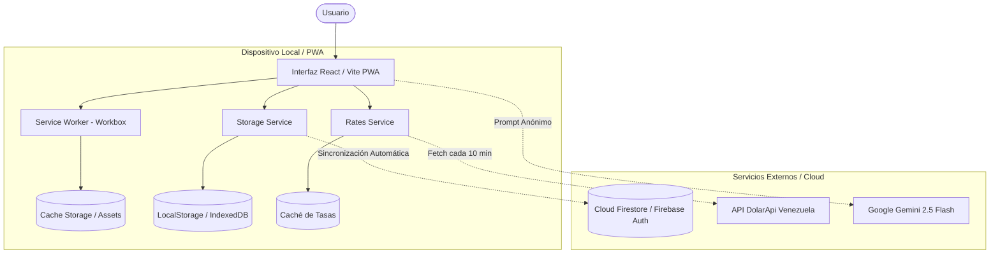

# 🇻🇪 Manual Técnico, Arquitectura y Guía de Despliegue Docker
## Finanzas Venezuela PWA — Control Multimoneda & Asesoría IA

---

## 📑 Tabla de Contenidos
1. [Introducción y Objetivos del Proyecto](#1-introducción-y-objetivos-del-proyecto)
2. [Arquitectura del Sistema (Offline-First)](#2-arquitectura-del-sistema-offline-first)
3. [Sistema Multimoneda Venezolano (USD, BCV, USDT)](#3-sistema-multimoneda-venezolano-usd-bcv-usdt)
4. [Estructura de Datos y Modelos (TypeScript)](#4-estructura-de-datos-y-modelos-typescript)
5. [Módulos Principales y Componentes](#5-módulos-principales-y-componentes)
6. [Motor de Inteligencia Artificial (Google Gemini)](#6-motor-de-inteligencia-artificial-google-gemini)
7. [Guía de Despliegue con Docker y Docker Compose](#7-guía-de-despliegue-con-docker-y-docker-compose)
8. [Instalación de la PWA en Dispositivos Móviles](#8-instalación-de-la-pwa-en-dispositivos-móviles)
9. [Variables de Entorno y Configuración](#9-variables-de-entorno-y-configuración)

---

## 1. Introducción y Objetivos del Proyecto

**Finanzas Venezuela PWA** es una aplicación web progresiva de alta fidelidad diseñada específicamente para resolver los desafíos de gestión financiera personal y de negocios en Venezuela:
- **Hiper-volatilidad y desdoblamiento cambiario:** Coexistencia de la tasa oficial del Banco Central de Venezuela (BCV) y el mercado libre/Binance USDT.
- **Conectividad inestable y cortes eléctricos:** La aplicación debe funcionar al 100% sin internet, registrando transacciones que se sincronizan automáticamente cuando la conexión se restablece.
- **Riesgo de descapitalización en Bolívares:** Detección automática del porcentaje de exposición a la moneda local y emisión de recomendaciones preventivas.

---

## 2. Arquitectura del Sistema (Offline-First)

La aplicación utiliza un patrón de diseño **Offline-First**, donde el dispositivo local actúa como la fuente primaria de datos inmediata, respaldada en la nube:



### Componentes Clave de la Arquitectura:
1. **Persistencia Local de Firestore (`persistentLocalCache`):**
   Utiliza el SDK modular v10 de Firebase configurado con `persistentMultipleTabManager()`. Si el dispositivo pierde internet, las transacciones se almacenan en la base de datos IndexedDB interna del navegador y se suben en lote a la nube tan pronto se detecta el evento `window.ononline`.
2. **Service Worker (`sw.js` generado por Workbox):**
   Descarga y almacena en caché todos los paquetes JS, CSS, fuentes e íconos. La aplicación carga instantáneamente sin depender de la red.
3. **Caché de Tasas de Cambio:**
   Las últimas tasas válidas de DolarApi se almacenan localmente. Además, cuenta con un editor manual para operar si la API externa experimenta caídas.
4. **Sistema de Tema Automático:**
   Un listener cronometrado evalúa la hora local:
   - **06:00 a 18:00:** Activa automáticamente el **Modo Claro**.
   - **18:00 a 06:00:** Activa automáticamente el **Modo Oscuro**.
   - Un botón en la barra superior permite alternar manualmente en cualquier momento.

---

## 3. Sistema Multimoneda Venezolano (USD, BCV, USDT)

El motor financiero calcula y audita el dinero en dos dimensiones concurrentes:

### 3.1. Tasas de Cambio
- **Tasa Oficial BCV:** Publicada por el Banco Central de Venezuela, aplicada por comercios formales y supermercados para el pago en Bolívares.
- **Tasa Paralelo / Binance USDT:** Precio promedio de mercado de reposición en operaciones P2P.

### 3.2. Fórmula de la Brecha Cambiaria
$$\text{Brecha Cambiaria (\%)} = \left( \frac{\text{Tasa USDT} - \text{Tasa BCV}}{\text{Tasa BCV}} \right) \times 100$$

Un valor superior al 10% activa indicadores visuales en color ámbar/rojo en el Dashboard, señalando distorsiones en el poder de compra.

### 3.3. Arbitraje y Transferencias entre Cuentas
Al transferir fondos entre cuentas de distinta moneda (ejemplo: pasar de **Binance USDT ($)** a **Banco Provincial (VES)**):
- Se debita el monto exacto en dólares de la cuenta origen.
- Se calcula el crédito resultante en bolívares multiplicando por la tasa del día:
  $$\text{Monto en Destino (VES)} = \text{Monto Origen (USD)} \times \text{Tasa Aplicada}$$
- El usuario puede modificar la tasa del movimiento si pactó un valor P2P diferente.

---

## 4. Estructura de Datos y Modelos (TypeScript)

### 4.1. Cuenta (`Account`)
```typescript
interface Account {
  id: string;
  name: string;
  type: 'bank_ves' | 'cash_usd' | 'wallet_crypto' | 'cash_ves' | 'custom';
  currency: 'USD' | 'VES';
  initialBalance: number;
  currentBalance: number;
  color: string;
  icon: string;
  bankCode?: string;
}
```

### 4.2. Transacción (`Transaction`)
```typescript
interface Transaction {
  id: string;
  type: 'income' | 'expense' | 'transfer';
  accountId: string;
  toAccountId?: string;          // Usado en transferencias
  amount: number;
  currency: 'USD' | 'VES';
  appliedRate?: number;          // Tasa en transferencias cruzadas
  destinationAmount?: number;    // Monto acreditado en destino
  categoryId: string;
  categoryName: string;
  date: string;                  // ISO 8601
  note?: string;
}
```

### 4.3. Meta Financiera (`FinancialGoal`)
```typescript
interface FinancialGoal {
  id: string;
  name: string;
  targetAmountUsd: number;
  currentSavedUsd: number;
  deadline: string;
  category: string;
}
```

---

## 5. Módulos Principales y Componentes

| Módulo | Componente | Responsabilidad |
| :--- | :--- | :--- |
| **Navbar** | `Navbar.tsx` | Ticker de tasas BCV/USDT, indicador de brecha, badge Online/Offline, selector de tema y autenticación Firebase. |
| **Dashboard** | `DashboardView.tsx` | Tarjetas de patrimonio dual, gráficos comparativos Ingresos vs. Egresos y Dona de gastos por categoría (Recharts). |
| **Movimientos** | `TransactionsView.tsx` | Tabla y listado interactivo con búsqueda en vivo, filtros temporales (Día, Semana, Mes, Año) y exportación a CSV. |
| **Modal Transacción** | `TransactionModal.tsx` | Registro en 3 clics de egresos, ingresos y cambios de divisas con vista previa dual inmediata en ambas monedas. |
| **Cuentas & Bancos** | `AccountsView.tsx` | Gestión de cuentas bancarias en Bs (BDV, Mercantil, Provincial, BNC, Tesoro) y cuentas en USD (Binance, Efectivo). |
| **Deudas** | `DebtsView.tsx` | Control bidireccional de Cuentas por Cobrar (Me deben) y Cuentas por Pagar (Yo debo a otros) con conversión dinámica a tasa BCV y balance neto. |
| **Portafolio** | `PortfolioView.tsx` | Desglose de liquidez disponible versus instrumentos de inversión (Cripto, Acciones, Inmuebles, Capital de Negocio). |
| **Proyecciones** | `ProjectionsView.tsx` | Simulador interactivo que calcula el tiempo estimado para alcanzar metas según el flujo neto mensual. |
| **Asesor IA** | `AiAdvisorView.tsx` | Diagnóstico económico personalizado generado por Google Gemini con estrategias de cobertura cambiaria. |

---

## 6. Motor de Inteligencia Artificial (Google Gemini)

El servicio `geminiService.ts` conecta con la biblioteca `@google/genai` (modelo `gemini-2.5-flash`).

### Privacidad y Seguridad:
- **Cero Datos Sensibles:** Nunca se envían nombres de usuario, números de cuenta, correos o datos identificatorios.
- **Payload Anónimo Estructurado:** Solo se envían agregados numéricos (Total Ingresos $, Total Egresos $, Distribución por categoría %, % de exposición en Bolívares y Brecha cambiaria).

### Diagnóstico Estructurado Retornado:
1. **Riesgo de Devaluación:** `BAJO`, `MODERADO`, `ALTO` o `CRÍTICO`.
2. **Diagnóstico del Flujo de Caja:** Ratio de ahorro y balance neto.
3. **Alertas de Sobrepresupuesto:** Identificación del rubro con mayor fuga de capital.
4. **Estrategia Antidevaluación Venezolana:** Recomendaciones prácticas de cuándo comprar a tasa BCV y cuándo dolarizar a USDT.
5. **Plan de Acción para Metas:** Aporte mensual sugerido para cumplir los objetivos.

> **Respaldo Heurístico sin Conexión:** Si el usuario no tiene conexión a internet o no ha colocado una API key, la aplicación ejecuta un motor de reglas económicas de alta precisión que genera el diagnóstico localmente en milisegundos.

---

## 7. Guía de Despliegue con Docker y Docker Compose

El proyecto incluye una configuración de contenedor de producción multi-etapa con **Node.js 22 (Alpine)** para la compilación y **Nginx 1.27 (Alpine)** para servir la PWA.

### 7.1. Requisitos Previos
- Docker Engine 20.10+ instalado.
- Docker Compose v2 o superior.

### 7.2. Despliegue Rápido (1 Solo Comando)
Desde la raíz del proyecto, ejecuta:
```bash
docker compose up -d --build
```
O usando el script de control incluido:
```bash
./docker-run.sh start
```

La aplicación estará lista en:
👉 **`http://localhost:8085`**

### 7.3. Personalización del Puerto
Si deseas ejecutar la aplicación en otro puerto (ejemplo: 80 o 3001), puedes definir la variable `APP_PORT`:
```bash
APP_PORT=3001 docker compose up -d
```

### 7.4. Comandos de Mantenimiento
```bash
# Ver estado del contenedor y verificación de salud
docker compose ps

# Ver registros (logs) en tiempo real
docker compose logs -f

# Detener el contenedor
docker compose down

# Reiniciar
docker compose restart
```

---

## 8. Conexión Multi-Dispositivo y Sincronización Local (Offline-First)

### 8.1. Direcciones IP para Conectar desde Otro Dispositivo
El servidor expone el puerto **8085** en todas las interfaces de red (`0.0.0.0:8085`). Conectando tu teléfono o laptop a la misma red:

- **Red Wi-Fi (Recomendado para móviles y tablets):**
  👉 **`http://192.168.1.121:8085`**
- **Red Ethernet / Cable (LAN empresarial o PC de escritorio):**
  👉 **`http://172.16.10.23:8085`**

### 8.2. Sincronización Local con Resolución por Fechas (Last-Write-Wins)
1. **Uso 100% Offline:** Cuando el teléfono o dispositivo no tiene conexión a internet ni a la red local (por ejemplo en la calle o durante cortes eléctricos), todos los movimientos, gastos y pagos se guardan inmediatamente en el almacenamiento local del dispositivo con su fecha y hora exacta (`updatedAt`).
2. **Reconexión a la red:** Una vez que el dispositivo se conecta a la misma red Wi-Fi del servidor, presiona el botón **"Sincronizar"** en la barra superior.
3. **Resolución Inteligente por Fecha (Last-Write-Wins):** El motor compara registro por registro entre el servidor y el cliente:
   - Si un registro fue modificado en ambos dispositivos, **prevalece automáticamente la última modificación según la fecha y hora** (`updatedAt`).
   - Los registros nuevos se agregan bidireccionalmente.
   - Las eliminaciones se propagan limpiamente mediante un registro de tumbas de eliminación (*tombstones*).

### 8.3. Instalación de la PWA en Dispositivos Móviles

Gracias al manifiesto web y al Service Worker, la aplicación se puede instalar como una aplicación nativa en cualquier teléfono:

### En Android (Google Chrome / Brave)
1. Abre `http://192.168.1.121:8085` en Chrome.
2. Presiona los tres puntos del menú superior derecho o el botón **"Instalar App"** en la barra superior.
3. Selecciona **"Instalar aplicación"** o **"Agregar a la pantalla principal"**.
4. La aplicación aparecerá en el cajón de aplicaciones con su icono, sin barra de navegación del navegador y con soporte offline.

### En iOS (Safari)
1. Abre `http://192.168.1.121:8085` en Safari.
2. Presiona el botón **Compartir** (icono de cuadrado con flecha hacia arriba).
3. Desplázate hacia abajo y selecciona **"Agregar al inicio"**.
4. Asigna el nombre y presiona **Agregar**.

---

## 9. Variables de Entorno y Configuración

Las variables se definen en el archivo `.env`:

```env
# Configuración de Firebase (Opcional en desarrollo local)
VITE_FIREBASE_API_KEY=AIzaSyDummyKeyForLocalOfflinePwaDevelopment
VITE_FIREBASE_AUTH_DOMAIN=finanzas-vzla-pwa.firebaseapp.com
VITE_FIREBASE_PROJECT_ID=finanzas-vzla-pwa
VITE_FIREBASE_STORAGE_BUCKET=finanzas-vzla-pwa.appspot.com
VITE_FIREBASE_MESSAGING_SENDER_ID=1234567890
VITE_FIREBASE_APP_ID=1:1234567890:web:abcdef

# Google Gemini API Key para el Asesor Financiero IA (Opcional, configurable también desde la UI)
VITE_GEMINI_API_KEY=

# Puerto de Docker
APP_PORT=8085
```

---

## 10. Despliegue en la Nube con Vercel y Flujo de CI/CD

La aplicación está optimizada para desplegarse en **Vercel** como una PWA estática conectada a **Firebase Firestore**:
* **Enrutamiento:** Gestionado mediante `vercel.json` para Single Page Application (SPA).
* **Flujo de Integración Continua (CI/CD):**
  Cada vez que se realiza un commit y push a la rama `main` en GitHub, Vercel detecta automáticamente los cambios, ejecuta `npm run build` y despliega la nueva versión en producción sin tiempo de inactividad:
  ```bash
  git add .
  git commit -m "Descripción de los cambios"
  git push
  ```
